# PhotoX

Personal photo and video hosting platform: one NestJS API (`core`), one BullMQ worker (`worker-service`), and a Vite/React `web` app, sharing Redis and local-disk storage, with a single Postgres DB owned by `core`. Media bytes stay on local disk; per-user backups land in S3-compatible object storage (Floci in dev).

## Architecture

[](docs/diagrams/architecture.html)

## Upload processing

[](docs/diagrams/data-flow.html)

## Features

- **Library** — timeline browsing, albums, favorites, trash, places (offline reverse geocoding), share links.
- **Uploads** — per-user SHA-256 dedupe fast-path; optional `STORAGE_QUOTA_BYTES` rejects over-quota uploads with 413 before any bytes are written.
- **Processing** — thumbnails (`sm/md/lg/xl`), EXIF/video metadata + dHash, AV1/Opus WebM transcode (h264+aac skips it; capped 720p, 4h/7680px inputs, 1h ffmpeg timeout), face detection (InsightFace SCRFD-10G) + 512-dim embeddings + DBSCAN clustering into People, Paddle OCR, YOLO26n object detections, SigLIP2 768-dim vision embeddings.
- **Search** — hybrid semantic + full-text (title, description, OCR text, detection labels) over pgvector, with person/place routing, plus duplicates and similar-photo lookups.
- **Backups** — admin per-user backup/restore to S3-compatible storage, incremental via a manifest written last.
- **Admin console** — five tabs: Overview, AI Pipelines (reprocess triggers + last-run status), Assets & Maintenance, Users, Backups.

## Prerequisites

- Node.js 22 (`.nvmrc`)
- pnpm 9.15 (see `packageManager`)
- Docker & Docker Compose

## Quick Start

```bash
# Install dependencies (root postinstall loops all 4 worker model scripts; FACE_MODEL_SKIP=1 to skip)
pnpm install

# Configure env, then re-diff .env against .env.example after every pull (new required keys land there)
cp .env.example .env
# Required: AUTH_TOKEN_SECRET + WORKER_JWT_SECRET (>= 32 chars each, must differ; both need entropy).
# Notables: AUTH_TOKEN_SECRET_PREVIOUS (rotation), REDIS_PASSWORD (photox_dev),
# CORE_URL, FACE_DETECTOR_MODEL_PATH, AUTH_* TTLs, RATE_LIMIT_REGISTER, STORAGE_QUOTA_BYTES,
# S3_*/AWS_* (backup storage).

# Start infrastructure (postgres + redis + floci, the local S3 that backs backups)
docker compose up -d postgres redis floci

# Run all apps in dev mode (hot reload)
pnpm dev

# Open the web app
open http://localhost:5173
```

Infrastructure only: `docker-compose.yml` runs `postgres` + `redis` + `floci` (S3-compatible store for backups, `:4566`) and publishes no core port (host dev reaches core at `:3000` directly). The e2e stack (`docker-compose.e2e.yml`, used by `pnpm test:e2e`) is self-contained and additionally builds/runs `core`, `worker-service` and `web` in containers.

## Commands

| Command                    | What it does                                                                                           |
| -------------------------- | ------------------------------------------------------------------------------------------------------ |
| `pnpm dev`                 | core + worker-service + web with hot reload                                                            |
| `pnpm build`               | build all packages                                                                                     |
| `pnpm test` / `test:watch` | unit + integration tests (integration uses Testcontainers — Docker must be running)                    |
| `pnpm lint` / `typecheck`  | ESLint (type-aware) / `tsc --noEmit` across all packages                                               |
| `pnpm format`              | Prettier write                                                                                         |
| `pnpm test:e2e`            | boot the self-contained e2e stack, then run the Playwright/BDD suite (report: `e2e/playwright-report`) |
| `pnpm verify`              | CI order: lint → `test --force` → typecheck → build → `E2E_BUILD=1 test:e2e`                           |

Single app: `pnpm --filter @photox/core dev` (also `@photox/worker-service`, `@photox/web`); any package script accepts the same `--filter`.

### Flags and env

- `--workers=N` — `pnpm verify --workers=4` / `pnpm test:e2e --workers=4`: Playwright's native worker flag, forwarded by `run.sh` to `playwright test`; runs the parallel `suite` project with N workers (default `1`, fully serial). The `setup` project — the features that mutate global state (face reprocess/recluster and the semantic-upload pipeline) — always runs first and serially, and `suite` depends on it; the seeded-admin check (core inserts an `ADMIN_EMAIL` admin on boot when none exists) runs in the parallel `suite`.
- `E2E_BUILD=1` — rebuild the `photox-e2e-*` images before booting the stack (`pnpm verify` sets it); without it existing images are reused.
- `E2E_KEEP=1` — keep the stack running after the suite (prints the web URL) and skip artifact cleanup.
- `E2E_PROJECT=` / `E2E_WEB_PORT=` — override the auto-generated compose project / web port. Each invocation is stack-isolated, but `e2e/.features-gen`, `e2e/test-results` and `e2e/playwright-report` are shared between concurrent runs.
- `FACE_MODEL_SKIP=1 pnpm install` — skip the root postinstall loop over all 4 worker model scripts.
- `ADMIN_EMAIL` / `ADMIN_PASSWORD` — seed an admin on core bootstrap when no admin exists (open registration only mints `user`); empty disables the seed.
- `pnpm --filter @photox/worker-service <script>` — 4 separate (re)download scripts in `apps/worker-service`: `face-model`, `vision-model`, `ocr-model`, `detect-model` (root `postinstall` loops all four).

Core health check (host dev): `curl localhost:3000/health`; Swagger UI at `http://localhost:3000/docs`.

## Services

| Service        | Port       | Description                                                                                                                                                 |
| -------------- | ---------- | ----------------------------------------------------------------------------------------------------------------------------------------------------------- |
| core           | 3000       | The only HTTP API (auth, assets, files, albums, shares, faces/persons, places, search, backups, admin)                                                      |
| worker-service | (internal) | BullMQ consumers: process-thumbnail, process-video, process-metadata, process-faces, process-faces-cluster, process-embeddings, process-detect, process-ocr |
| web            | 5173       | React frontend (proxies `/api`, `/worker` and `/health` to core)                                                                                            |
| postgres       | 5432       | PostgreSQL (pgvector image; single `photox` DB)                                                                                                             |
| redis          | 6379       | Redis (BullMQ queues)                                                                                                                                       |
| floci          | 4566       | S3-compatible object store backing per-user backups (dev/local)                                                                                             |

`core` also runs one BullMQ consumer of its own (`user-delete`, async account deletion) and the inline orphan sweep (`POST /api/v1/admin/cleanup-orphans/run`). Media lives on local disk (`STORAGE_DIR`, default `./data/storage`) shared by core and worker — the object store above only holds backups.

## Security

- Worker → core calls carry a per-job delegated JWT (minted with `WORKER_JWT_SECRET`, always `role: 'user'`) plus the `X-Job-Signature` HMAC stamped at enqueue (fail-closed, replay confined to the asset).
- Sessions: HS256 access JWT + rotated opaque refresh token in the HttpOnly `photox_access` cookie; passwords are argon2; registration is rate-limited per IP (`RATE_LIMIT_REGISTER`, default 10/hour).
- Original uploads are checked against per-user `STORAGE_QUOTA_BYTES` after the dedup fast-path — over quota rejects with 413 before any bytes are written. Video transcodes retry once (`attempts: 2`, each retry can cost ~1h of AV1).

## Share links

- Re-sharing an asset/album **rotates** the link: a new token is minted and the old URL immediately 404s.
- Share tokens are stored hashed — plaintext exists only in the create response, so copy the link when you create it (the Shared page re-shares on copy for the same reason).
- Pre-hash share rows still resolve via a plaintext fallback but never expire — re-share to hash them, attach the 30d expiry, and rotate the URL.
- New shares expire after 30d; older shares with no expiry never expire.
- Upgrade note for pre-expiry DBs only (fresh DBs already get token `varchar(64)` + `expiresAt` via the baseline migration): widen `shares.token` and add the nullable column by hand before booting a non-production core (dev/CI boots run TypeORM `synchronize`; production applies migrations) — `ALTER TABLE shares ALTER COLUMN token TYPE varchar(64); ALTER TABLE shares ADD COLUMN "expiresAt" timestamptz NULL;` — pre-expiry DBs have been seen to fail that boot on `column "token" contains null values` without it.

## Backups

- Admin-only, per-user: a backup writes the user's DB rows + original bytes under `S3_BACKUP_PREFIX` (default `backups/`); `manifest.json` is written last. Reruns are incremental — unchanged objects are skipped via the previous manifest.
- A restore re-enqueues derivatives (thumbnails, transcodes) for restored originals. A restore under a different email immediately re-homes the S3 prefix and manifest to the restored address (the old prefix is deleted), while a same-email restore leaves them in place; a failed move is reported and completed by the next backup. Keep the admin orphan sweep paused for the whole restore — a mid-restore sweep deletes files the manifest still expects.
- Deleting a user wipes their media but never their backup; deleted users' backups stay restorable from the admin Backups tab. A snapshot whose email matches a live account (a re-registered address) is shown on that live row as a previous-account backup and can be merged into it.
- Merge is additive: profile fields are not copied, duplicate originals are deduped by checksum, and album/share links are remapped; shares are preserved when their token is free. A merge moves the source snapshot into the live account's own prefix (union with its existing backup) and deletes the source prefix, so the adopted snapshot is no longer independently restorable — its manifest `userId` is the live account. A merge ledger still blocks repeat merges. Keep the admin orphan sweep paused during a merge (same as a restore); quota is enforced unless an operator forces the merge.

## Admin setup

Open registration only mints role `user`, so a fresh instance needs an admin one of three ways:

- **A. Env seed** (simplest for compose): set `ADMIN_EMAIL` + `ADMIN_PASSWORD` — core inserts that admin on bootstrap when no admin exists. Empty env disables the seed (dev/CI default).
- **B. CLI recovery** (works even when an admin already exists — it promotes/creates unconditionally): `pnpm --filter @photox/core admin:create` (interactive prompts; `--email=`/`--password=` flags for scripts).
- **C. SQL fallback** (promote an existing user; needs DB access):
  ```sql
  UPDATE users SET role = 'admin' WHERE email = 'you@example.com';
  ```

## Layout

- `apps/core` — NestJS API (`@photox/core`)
- `apps/worker-service` — BullMQ consumers (`@photox/worker-service`), no DB access — talks to core over HTTP
- `apps/web` — Vite + React (`@photox/web`)
- `apps/core/src/database` — TypeORM entities + DB module (core only)
- `packages/shared-config` / `shared-types` — zod env + local storage, JWT payload/wire types
- `docs/diagrams` — the two README diagrams (self-contained HTML + SVG)
- `e2e` — Playwright + playwright-bdd suite (self-contained container stack, `pnpm test:e2e`)

See `AGENTS.md` for architecture details.
